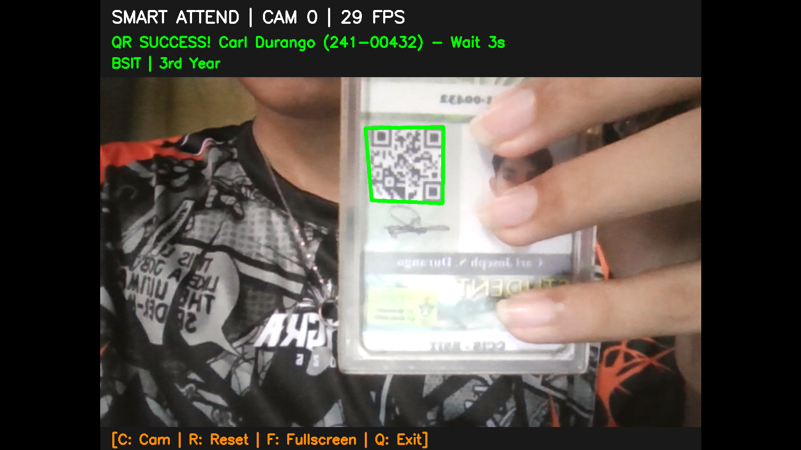

# SmartAttend: Real-Time Face and QR Code Attendance System

**Course:** CSC-126 Midterm Project  
**Developers:** Durango, Faisan, Entoma  

## Project Description
**SmartAttend** is a real-time attendance tracking system created using Python and OpenCV. It is designed to make classroom attendance faster and prevent students from scanning on behalf of absent classmates. The program uses a webcam to detect a student's face and read their Student ID QR code at the same time. Once verified, it finds the student's information (Name, Course, and Year Level) from a connected student list and automatically records their attendance with the date and time in a CSV file.

### Main Features
* **Image Adjustment:** Flips the camera view, resizes frames, converts images to grayscale, and improves contrast so QR codes remain easy to read even in dim lighting or glare.
* **Face and QR Code Detection:** Uses OpenCV tools to locate a student's face and scan their Student ID QR code simultaneously.
* **Smooth Video Performance:** Runs face and QR detection in the background so the live camera window stays fast and smooth without lagging.
* **Flexible Student Database:** Loads student details (`Student_ID`, `Name`, `Course`, `Year_Level`) from a published Google Sheets CSV link or a local `students.csv` file, and includes a built-in backup list for offline use.
* **Automatic Attendance Recording:** Saves verified scans with timestamps into `attendance_log.csv` and applies a 5-second waiting period to prevent duplicate entries.
* **Clear On-Screen Display:** Shows boxes around detected faces, camera frame rate (FPS), verification messages, and lets users switch between available cameras.

---

## Setup Instructions

### 1. System Requirements
* Python 3.8 or higher (Tested on Python 3.15)
* OpenCV (`opencv-python==4.10.0.84`)
* A working built-in or external webcam

### 2. Download the Project
Clone this repository to your computer using the terminal:
```bash
git clone [https://github.com/carldurango/CSC126-MIDTERM-PROJECT-Durango-Faisan-Entoma.git](https://github.com/carldurango/CSC126-MIDTERM-PROJECT-Durango-Faisan-Entoma.git)
cd CSC126-MIDTERM-PROJECT-Durango-Faisan-Entoma
```

### 3. Install Required Libraries
Install the needed package listed in `requirements.txt`:
```bash
pip install -r requirements.txt
```

### 4. Connect a Student List (Optional)
The program already includes a built-in backup list (`FALLBACK_ROSTER`) for immediate testing. To use your own student list:
1. Open `main.py` and find `DATABASE_LINK` near the top of the file.
2. Paste your published **Google Sheets CSV link** or type the name of a local CSV file (such as `"students.csv"`) containing these four columns: `Student_ID`, `Name`, `Course`, and `Year_Level`.

---

## How to Run the Application

1. Open your terminal in the project folder and run:
   ```bash
   python main.py
   ```
2. Wait for the **SmartAttend Dashboard** window to appear.
3. Face the webcam until a yellow box appears around your face, then hold your Student ID QR code in front of the camera.
4. Once verified, the box turns **green**, your Name, Course, and Year Level appear on the screen, and your attendance is saved to `attendance_log.csv`.

### Keyboard Controls
Click inside the **SmartAttend Dashboard** window and press any of these keys:
* **`c`** — Switch to the next connected camera.
* **`r`** — Clear all saved records in `attendance_log.csv`.
* **`q`** — Safely stop the program and close the camera window.


## Sample Output


